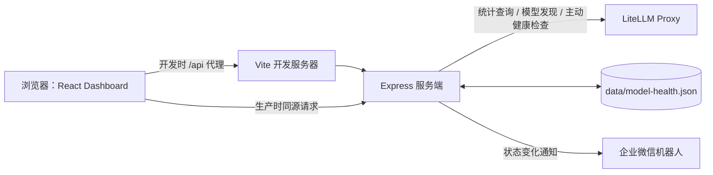

# 当前架构说明

本文依据当前代码梳理系统的实际结构与运行方式，重点记录模块边界、数据流、接口和运行限制。代码是最终事实来源；功能变化后应同步更新本文。

## 1. 系统概览

这是一个单体部署的 LiteLLM 用量与模型健康 Dashboard：React 单页应用负责展示和交互，Express 服务端负责对接 LiteLLM、运行模型健康检查、提供本地 API，并在生产模式下托管前端静态文件。



生产部署只有一个 Node 服务进程，不需要独立数据库、Redis 或任务队列。统计信息不在 Dashboard 侧持久化；模型健康记录保存在服务端本机 JSON 文件中。

## 2. 技术栈与启动入口

| 层 | 实现 | 入口/配置 |
| --- | --- | --- |
| 前端 | React 19、TypeScript、Vite、Tailwind CSS 4、Radix/shadcn 风格组件、Recharts | `src/main.tsx`、`src/App.tsx` |
| 服务端 | Node.js、Express 5、TypeScript；开发时由 `tsx` 执行 | `server/index.ts` |
| 模型健康功能 | Express Router、Node 文件系统、进程内定时器 | `server/model-health.ts` |
| 构建 | TypeScript 编译检查、Vite 生成静态产物 | `npm run build`，输出到 `dist/` |
| 开发 | 并行启动 Express watch 和 Vite | `npm run dev`；Vite 将 `/api` 转发至 `localhost:3001` |
| 生产 | Express API 与 `dist` 静态托管共进程 | `npm start`；监听 `PORT`，默认 `3001` |

`src/App.tsx` 根据侧栏选择在“用量概览”和“模型健康”之间切换，页面状态由 React 管理，没有独立客户端路由器。导航中其余页面目前渲染空内容占位。

## 3. 模块职责

### 前端

- `src/main.tsx` 挂载 React 应用、主题和全局样式。
- `src/App.tsx` 负责概览页布局和 `/api/usage` 的首次加载、手动刷新及每分钟轮询。
- `src/components/section-cards.tsx` 展示今日和最近 7 天汇总指标。
- `src/components/chart-area-interactive.tsx` 展示 Token 折线图和按年热力图，支持日期范围与模型筛选；趋势响应在 `sessionStorage` 中按筛选参数缓存 60 秒，并用 AbortController 取消过期请求。
- `src/components/data-table.tsx` 展示每日明细及近 7 天合计。
- `src/components/model-health-page.tsx` 管理健康状态、历史、手动检查和设置交互；页面每 30 秒刷新一次。
- `src/components/ui/` 是界面原语组件；`src/lib/usage.ts` 定义共享用量类型和格式化函数。

图表趋势组件接收概览数据属性，但当前自身趋势数据由 `/api/usage/trend` 独立读取。

### 服务端

- `server/index.ts` 加载 `.env`，注册健康监控路由，处理用量查询和 `/api/health`，并在生产模式托管前端。
- `server/model-health.ts` 负责 LiteLLM 部署发现、并发健康探测、状态变化判定、Webhook 告警、设置和历史 API、本地文件读写及定时调度。

服务端用 `LITELLM_API_BASE` 和 `LITELLM_API_KEY` 构造上游请求。API Key 只由服务端持有，前端响应不会返回该值。

## 4. 核心数据流

### 用量概览

1. 浏览器请求 `GET /api/usage`。
2. Express 以 Bearer Key 调用 LiteLLM `/user/daily/activity/aggregated`，查询按上海时区计算的今天及前 6 天。
3. 服务端兼容数组或 `results`、`data`、`daily_activity`、`items`、`by_date` 等常见响应包装，提取 Token、请求数和花费；缺失日期补零。
4. 返回 `{ days, today, updatedAt, source, requestSource }`。客户端每分钟重新请求。

统计查询没有服务端缓存。上游请求超时为 30 秒；缺少 LiteLLM 配置时返回 503，上游失败时返回 502。

### 趋势和热力图

1. 图表按开始日期、结束日期和可选模型构造 `GET /api/usage/trend`。
2. 服务端校验日期顺序和最多 366 天跨度，再请求同一个聚合接口；模型参数存在时向上游传递，并优先使用模型 breakdown。
3. 服务端补齐日期序列、返回日指标和可用模型选项。特定的 LiteLLM 空聚合异常会作为零用量区间处理。
4. 浏览器以查询参数为键在 `sessionStorage` 缓存响应 60 秒；过期缓存可先展示，同时重新拉取。

### 模型健康与告警

1. 服务启动后读取 JSON 存储并安排定时任务；没有历史检查或最后检查已超过配置间隔时，启动时立即执行检查。
2. 检查前调用 LiteLLM `/model/info`，按照 include/exclude 通配模式筛选部署。排除规则优先，匹配模型公开名称或部署 ID。
3. 对每个部署调用 `POST /health/test_connection`，同时运行数量由 `MODEL_HEALTH_CONCURRENCY` 控制；单次请求超时受 `MODEL_HEALTH_TIMEOUT_MS` 控制。
4. 部署结果按模型聚合：全部健康为 `healthy`，部分健康为 `degraded`，全部失败为 `unhealthy`。记录每个部署的状态、检查时间、端到端接口耗时和错误摘要。
5. 只有符合状态变化条件且模型在关注列表中的事件才尝试发企业微信通知。空关注列表表示全部模型。异常和恢复事件及通知结果写入 JSON。
6. 前端每 30 秒读取状态、配置、历史；用户也可以触发立即检查、保存间隔/关注列表/Webhook 或测试通知。

状态变化规则当前包括：首次发现模型即异常、健康转异常、部分异常转完全不可用，以及异常状态转为健康。部分异常之间的变化不产生告警。响应耗时代表 Dashboard 到 LiteLLM 检查接口的总耗时，不是纯上游模型 TTFT。

## 5. HTTP API

| 方法与路径 | 用途 | 主要输入/输出 |
| --- | --- | --- |
| `GET /api/health` | 检查服务是否配置 LiteLLM | 返回配置布尔值和 base URL |
| `GET /api/usage` | 查询最近 7 天日汇总 | 返回 `days`、`today` 和更新时间 |
| `GET /api/usage/trend` | 查询日期区间/可选模型的日汇总 | 查询参数 `startDate`、`endDate`、`model`；最多 366 天 |
| `GET /api/model-health/config` | 读取监控设置和可用模型 | 返回模型列表、间隔、过滤规则、Webhook 是否已配置和运行状态；不会返回 Webhook URL |
| `PUT /api/model-health/config` | 更新间隔、关注模型和 Webhook | JSON body；可用 `clearWebhook: true` 清除 Webhook |
| `POST /api/model-health/config/test-webhook` | 发送测试告警 | 需先配置并保存 Webhook |
| `GET /api/model-health/history` | 查询检查记录和事件 | 支持 `days`（1–180）、`start`、`end`、`model` |
| `GET /api/model-health/status` | 查询最新模型/部署状态 | 返回模型聚合状态、部署明细、运行状态 |
| `POST /api/model-health/check` | 立即运行一轮健康检查 | 检查进行中返回 409；失败返回 502 |

开发时 API 请求由 Vite 转发到 Express；生产环境 API 与静态页面同源。除 JSON body 大小限制外，当前代码没有配置身份认证、授权或 API 速率限制。

## 6. 配置与持久化

配置项在 `.env.example` 中列出：

| 配置 | 用途 |
| --- | --- |
| `LITELLM_API_BASE`、`LITELLM_API_KEY` | LiteLLM 地址与服务端凭证 |
| `PORT` | Express 监听端口，默认 `3001` |
| `MODEL_HEALTH_INTERVAL_MINUTES` | 初始健康检查间隔，默认 15 分钟；页面保存后以 JSON 配置为准 |
| `MODEL_HEALTH_INCLUDE_MODELS`、`MODEL_HEALTH_EXCLUDE_MODELS` | 服务端模型/部署过滤通配模式 |
| `MODEL_HEALTH_TIMEOUT_MS`、`MODEL_HEALTH_CONCURRENCY` | 检查超时和并发度 |
| `WEWORK_WEBHOOK_URL` | 本地配置不存在时的初始 Webhook 值 |
| `MODEL_HEALTH_DATA_FILE` | 健康数据文件路径；未在 `.env.example` 中列出，默认 `data/model-health.json` |

健康配置、检查记录和事件序列化在同一 JSON 文件。写入时先生成临时文件再 rename，降低半写入文件风险。记录保留策略为最多 60 天，事件最多保留 2000 条。`data/` 被 `.gitignore` 忽略，因此配置和历史属于实例本地状态，发布或更换机器时需自行迁移/备份。

## 7. 运行边界与已知限制

- 定时器和运行锁均为进程内状态；设计目标是单个服务实例。多实例会各自执行检查并尝试写同一类本地数据，无法保证互斥或一致性。
- 本地 JSON 文件不是并发数据库，没有跨进程锁、事务查询或索引；历史记录增长和多实例部署需要替换持久化层。
- 当前 Express API 没有内置用户登录或访问控制。部署到不可信网络前，应由受控反向代理/网络边界保护，并评估访问控制需求。
- Webhook URL 保存在本地 JSON 文件中；错误摘要会进行常见密钥模式脱敏，但仍应限制数据目录权限。
- `/api/model-health/status` 与 `/config` 会在请求时重新发现 LiteLLM 模型；上游不可用时状态接口尽量保留最近检查结果，配置接口返回 `modelsError`。
- 用量查询来自 LiteLLM 聚合活动接口；其中请求数统计口径是聚合记录的请求数，可能与网关入口请求数不同。实现没有依赖 Enterprise `/global/spend/report` 或部分版本缺失的旧接口。
- `src/app/dashboard/data.json` 是当前仓库中未被引用的模板样例数据，不参与现有用量或健康监控数据流。
- `src/App.tsx` 中侧栏未实现的页面仍是空占位；当前有效业务页面是用量概览和模型健康。

## 8. 代码导航

```text
src/
  App.tsx                          应用壳、导航切换、用量概览数据拉取
  main.tsx                         React 挂载与主题
  components/
    section-cards.tsx               今日/近 7 天统计卡
    chart-area-interactive.tsx       趋势图、热力图、模型与日期筛选
    data-table.tsx                   每日表格和区间汇总
    model-health-page.tsx            模型健康 UI 和配置操作
    app-sidebar.tsx、site-header.tsx  页面框架
    ui/                              基础交互组件
  lib/usage.ts                       用量类型及格式化
server/
  index.ts                           用量 API、静态资源托管、服务启动
  model-health.ts                    健康检查、告警、配置 API 与 JSON 存储
data/
  model-health.json                  运行时本地状态文件（忽略跟踪）
```
